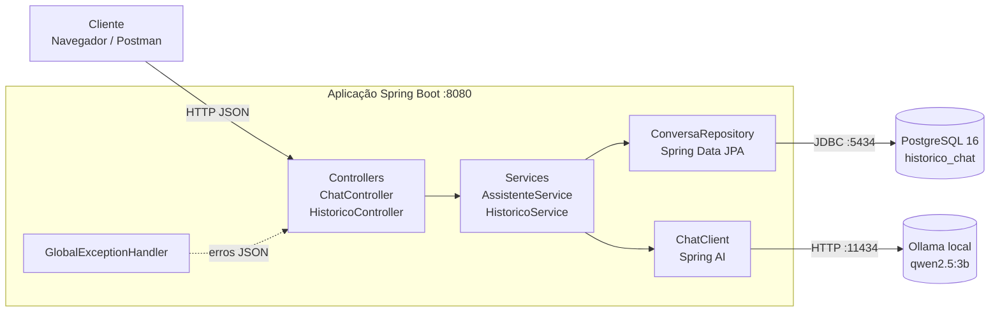
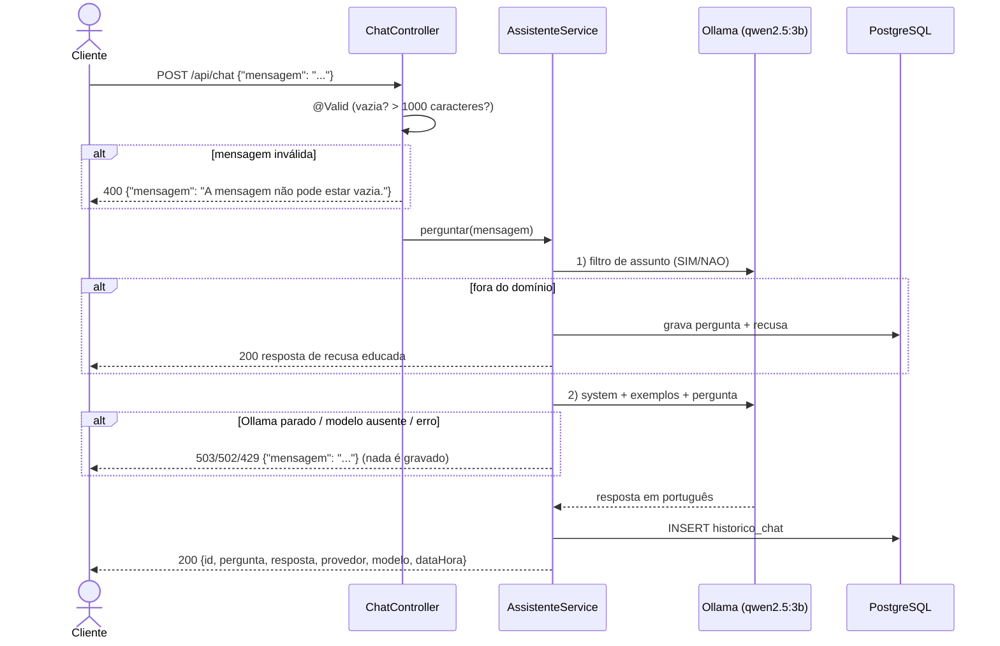
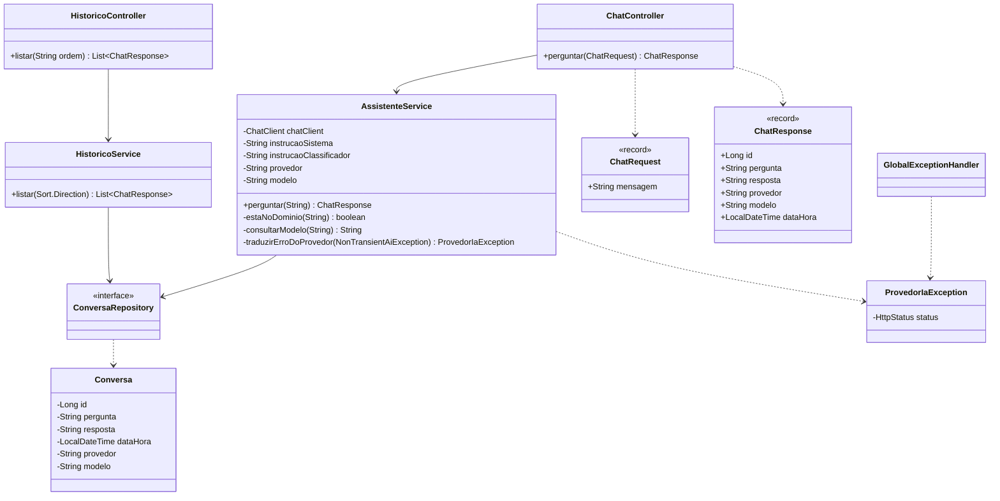
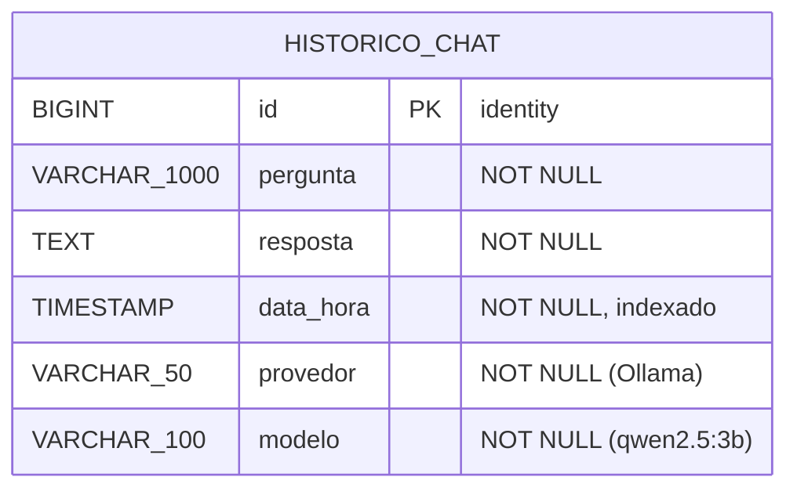
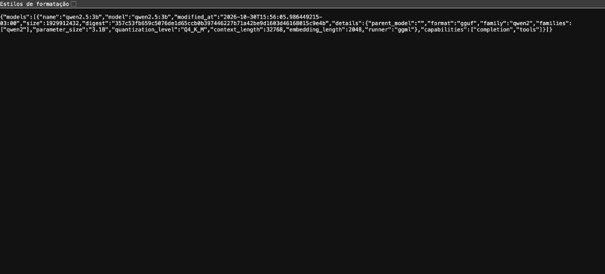
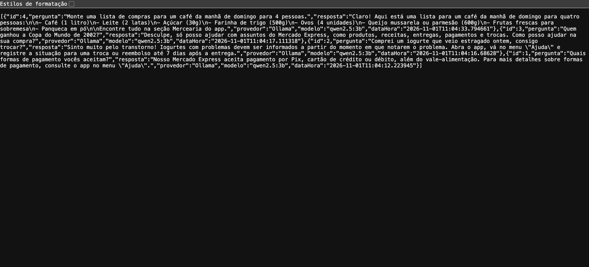
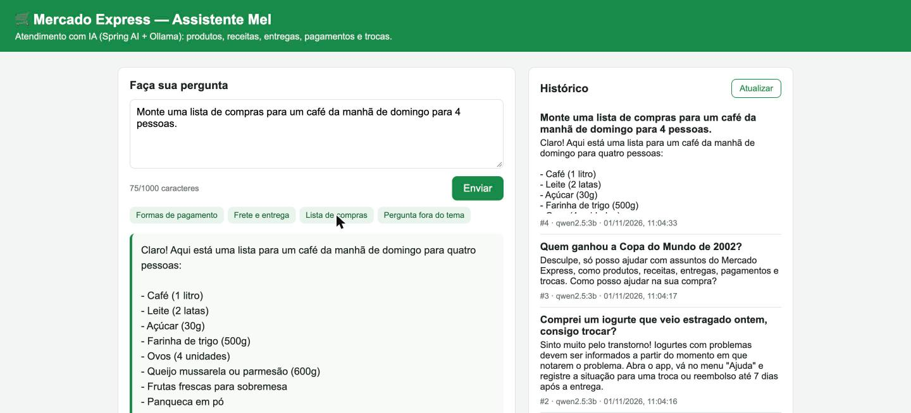
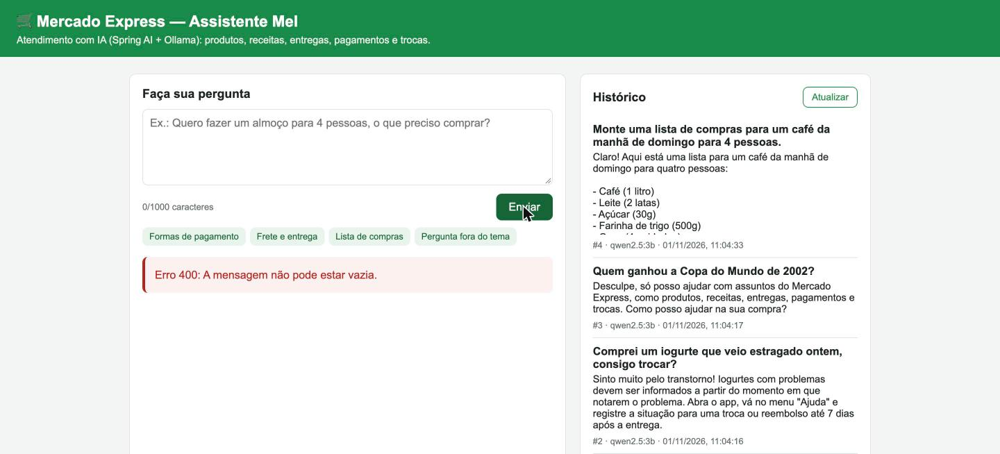

# 🛒 Mercado Express AI — Assistente de Atendimento com Spring AI + Ollama

**Checkpoint 6 — Java Advanced** · Prof. Dr. Marcel Stefan Wagner
FIAP · Tecnologia em Análise e Desenvolvimento de Sistemas (TDS) · Turma **2TDSR**

| Integrante | RM |
|---|---|
| Erick Bernardes Bradaschia | RM565733 |
| Gabriel Santos Claudino | RM564054 |
| Jonathan Moreira Gomes | RM565060 |
| Kaiky de Oliveira Silva | RM566067 |
| Lucas Fortes de Lima | RM559523 |

---

🎥 **Vídeo de demonstração:** LINK_VIDEO

## 1. Objetivo

Aplicação **Java + Spring Boot + Spring AI** que funciona como a **"Mel"**, assistente virtual de atendimento do
**Mercado Express** (supermercado online, o mesmo domínio usado nos checkpoints anteriores do grupo).

A assistente:

- recebe perguntas dos clientes pela **interface web** ou pela **API REST** (`POST /api/chat`);
- consulta um **modelo de IA executado localmente pelo Ollama** (`qwen2.5:3b`), sem chave de API e sem custo;
- responde **sempre em português**, dentro do domínio do supermercado (produtos, listas de compras, receitas,
  conservação de alimentos, entrega, frete, pagamento, trocas e devoluções);
- **recusa educadamente** assuntos fora do domínio (esportes, programação, investimentos...);
- **registra todo o histórico** (pergunta, resposta, data/hora, provedor e modelo) no **PostgreSQL**, consultável em
  `GET /api/historico`.

## 2. Versões utilizadas

| Tecnologia | Versão |
|---|---|
| Java (JDK) | **21** (LTS) |
| Spring Boot | **4.1.2** |
| Spring AI | **2.0.1** (BOM `spring-ai-bom`) |
| Starter de IA | `spring-ai-starter-model-ollama` (único provedor ativo) |
| Ollama | 0.40.x |
| Modelo | **qwen2.5:3b** (3,1 B parâmetros, Q4_K_M, ~1,9 GB) |
| Banco de dados | PostgreSQL **16** (Docker) |
| Persistência | Spring Data JPA / Hibernate |
| Build | Maven 3.9 via **Maven Wrapper** (`mvnw`) |
| Testes | JUnit 5, Mockito, MockMvc, H2 (somente nos testes) |
| IDE | IntelliJ IDEA |

> As versões de Spring Boot 4.1.x e Spring AI 2.0.x são compatíveis entre si (o próprio Spring Initializr indica o
> Spring AI 2.0.1 para o Boot 4.1.2). Projeto gerado pelo **Spring Initializr** com: Spring Web, Spring Data JPA,
> PostgreSQL Driver, Validation e Ollama.

## 3. Arquitetura

### 3.1 Visão geral



Camadas (injeção de dependências por construtor):

| Pacote | Responsabilidade |
|---|---|
| `controller` | Endpoints REST `POST /api/chat` e `GET /api/historico` |
| `service` | `AssistenteService` (prompt, chamada ao modelo, tratamento de falhas, gravação) e `HistoricoService` |
| `repository` | `ConversaRepository` (Spring Data JPA) |
| `model` | Entidade `Conversa` → tabela `historico_chat` |
| `dto` | `ChatRequest` (validação), `ChatResponse`, `ErroResponse` |
| `exception` | `ProvedorIaException` e `GlobalExceptionHandler` (status HTTP + mensagem amigável) |
| `resources/prompts` | Instrução de sistema (`sistema.st`) e do filtro de assuntos (`classificador.st`) |
| `resources/static` | Interface web (`index.html`) |

### 3.2 Fluxo de uma pergunta



### 3.3 Diagrama de classes



### 3.4 Modelo de dados (ER)



## 4. Prompt (instrução de sistema)

O prompt fica em [`src/main/resources/prompts/sistema.st`](src/main/resources/prompts/sistema.st) e define:

| Item exigido | Como foi definido |
|---|---|
| **Papel** | "Você é a Mel, assistente virtual de atendimento do Mercado Express" |
| **Domínio** | produtos de supermercado, listas de compras, receitas, conservação de alimentos, entrega, pagamento, trocas e devoluções + **informações oficiais da loja** (área de entrega, horário, frete grátis acima de R$ 150, formas de pagamento, política de trocas) |
| **Idioma** | sempre português do Brasil, mesmo se a pergunta vier em outro idioma |
| **Limites** | no máximo 150 palavras; **nunca citar preços** nem estoque; não pedir dados sensíveis (senha, cartão, CPF); não dar orientação médica/nutricional; não tratar de outros assuntos |

Técnicas usadas para o modelo local pequeno (3B) seguir as regras:

1. **Filtro de assunto** ([`classificador.st`](src/main/resources/prompts/classificador.st)): antes de responder, uma
   chamada curta ao próprio modelo (temperatura 0, até 3 tokens) classifica a pergunta como **SIM/NAO**. Se for
   "NAO", a API devolve a recusa educada. Separar "classificar" de "responder" deixou o modelo muito mais
   consistente do que um único prompt com todas as regras.
2. **Few-shot**: exemplos de pergunta/resposta (troca de produto, lista de compras, frutas da estação) enviados
   via `ChatClient.prompt().messages(...)` mostram o tom e o formato esperados.
3. **Lembrete junto da pergunta**: reforça idioma, tamanho e "sem preços" (só a pergunta original é gravada).
4. **Parâmetros**: `temperature=0.2`, `repeat-penalty=1.2` (evita listas repetitivas) e `num-predict=350`.

Uso do Spring AI na camada de serviço (`AssistenteService`):

```java
resposta = chatClient.prompt()
        .system(instrucaoSistema)        // papel, domínio, idioma e limites
        .messages(EXEMPLOS)              // few-shot
        .user(comLembrete(pergunta))
        .call()
        .content();
```

## 5. Como executar

### 5.1 Pré-requisitos

- JDK 21
- Docker (para o PostgreSQL) — ou um PostgreSQL instalado localmente
- Ollama

### 5.2 Ollama (provedor de IA local)

**Windows**

1. Baixe e instale: <https://ollama.com/download/windows>. Abra o Ollama e um novo PowerShell.
2. `ollama --version`
3. `ollama pull qwen2.5:3b`
4. `ollama list` (o modelo deve aparecer) e, para testar, `ollama run qwen2.5:3b` → pergunte algo → `/bye`
5. Acesse <http://localhost:11434/api/tags> — o JSON deve listar o modelo.

**macOS**: `brew install ollama` → `ollama serve` (ou abra o app) → mesmos passos 3 a 5.

> Computador com pouca memória? Use `ollama pull llama3.2:1b` e rode a aplicação com
> `OLLAMA_MODEL=llama3.2:1b`. O nome configurado precisa ser **idêntico** ao exibido em `ollama list`.



### 5.3 Banco de dados (PostgreSQL)

**Opção A — Docker (recomendado)**: na raiz do projeto:

```bash
docker compose up -d        # (ou docker-compose up -d) sobe o postgres-cp6-ai na porta 5434
```

O [`docker-compose.yml`](docker-compose.yml) já cria o banco `mercado_express_ai` e o usuário `mercado` (senha de
exemplo `mercado123`, apenas para ambiente local).

**Opção B — PostgreSQL instalado na máquina**:

```bash
psql -U postgres -f scripts/01-criar-banco.sql
psql -h localhost -p 5432 -U mercado -d mercado_express_ai -f scripts/02-criar-tabela.sql
```

e informe a URL ao rodar a aplicação: `DB_URL=jdbc:postgresql://localhost:5432/mercado_express_ai`.

A tabela é criada automaticamente pelo JPA (`ddl-auto=update`); o script
[`02-criar-tabela.sql`](scripts/02-criar-tabela.sql) tem a mesma estrutura, e
[`03-consultas.sql`](scripts/03-consultas.sql) traz as consultas para conferir os registros.

### 5.4 Subir a aplicação

```bash
# Linux/macOS
./mvnw spring-boot:run

# Windows (PowerShell/CMD)
mvnw.cmd spring-boot:run
```

Acesse **<http://localhost:8080>** (interface) — ou use a coleção do Postman.

### 5.5 Configuração (application.properties)

Todas as configurações aceitam **variáveis de ambiente** (nada de credenciais no código):

| Propriedade | Variável de ambiente | Padrão |
|---|---|---|
| `server.port` | `PORT` | `8080` |
| `spring.datasource.url` | `DB_URL` | `jdbc:postgresql://localhost:5434/mercado_express_ai` |
| `spring.datasource.username` | `DB_USERNAME` | `mercado` |
| `spring.datasource.password` | `DB_PASSWORD` | `mercado123` (exemplo local) |
| `spring.ai.ollama.base-url` | `OLLAMA_BASE_URL` | `http://localhost:11434` |
| `spring.ai.ollama.chat.model` | `OLLAMA_MODEL` | `qwen2.5:3b` |

```properties
spring.ai.model.chat=ollama
spring.ai.ollama.base-url=${OLLAMA_BASE_URL:http://localhost:11434}
spring.ai.ollama.chat.model=${OLLAMA_MODEL:qwen2.5:3b}
spring.ai.ollama.chat.temperature=0.2
spring.ai.ollama.chat.repeat-penalty=1.2
spring.ai.ollama.chat.num-predict=350
spring.http.clients.connect-timeout=5s
spring.http.clients.read-timeout=90s
spring.ai.retry.max-attempts=2
```

> No Spring AI 2.0 a propriedade `spring.ai.ollama.chat.options.model` (citada no roteiro do CP) foi
> **depreciada** e substituída por `spring.ai.ollama.chat.model`, que é a usada aqui.
> O Ollama local **não usa chave de API**; se o grupo trocasse para OpenAI/DeepSeek, a chave entraria apenas por
> variável de ambiente (`OPENAI_API_KEY` / `DEEPSEEK_API_KEY`).

## 6. API REST

### `POST /api/chat`

Requisição:

```http
POST http://localhost:8080/api/chat
Content-Type: application/json

{ "mensagem": "Quais formas de pagamento vocês aceitam?" }
```

Resposta **200 OK** (exemplo real; o texto gerado varia entre execuções):

```json
{
  "id": 1,
  "pergunta": "Quais formas de pagamento vocês aceitam?",
  "resposta": "Nosso Mercado Express aceita pagamento por Pix, cartão de crédito ou débito, além do vale-alimentação. Para mais detalhes sobre formas de pagamento, consulte o app no menu \"Ajuda\".",
  "provedor": "Ollama",
  "modelo": "qwen2.5:3b",
  "dataHora": "2026-11-01T11:04:12.223945"
}
```

Pergunta fora do domínio (`{"mensagem": "Quem ganhou a Copa do Mundo de 2002?"}`) → **200 OK**:

```json
{
  "id": 3,
  "pergunta": "Quem ganhou a Copa do Mundo de 2002?",
  "resposta": "Desculpe, só posso ajudar com assuntos do Mercado Express, como produtos, receitas, entregas, pagamentos e trocas. Como posso ajudar na sua compra?",
  "provedor": "Ollama",
  "modelo": "qwen2.5:3b",
  "dataHora": "2026-11-01T11:04:17.111318"
}
```

### Validação e tratamento de falhas

Todos os erros seguem o mesmo formato JSON, **sem expor URLs internas, chaves ou stack trace** (o detalhe técnico vai
apenas para o log do servidor):

```json
{ "status": 400, "erro": "Bad Request", "mensagem": "A mensagem não pode estar vazia.", "dataHora": "2026-11-01T10:45:24.429162" }
```

| Situação | Status | Mensagem |
|---|---|---|
| `mensagem` vazia, só espaços ou ausente | **400** | A mensagem não pode estar vazia. |
| `mensagem` com mais de 1000 caracteres | **400** | A mensagem deve ter no máximo 1000 caracteres. |
| JSON mal formado | **400** | Corpo da requisição inválido. Envie um JSON no formato {"mensagem": "sua pergunta"}. |
| Sem `Content-Type: application/json` | **415** | Use o cabeçalho Content-Type: application/json. |
| Ollama parado / falha de conexão / timeout | **503** | Não foi possível conectar ao Ollama. Verifique se o serviço está em execução e tente novamente. |
| Modelo não instalado no Ollama | **503** | O modelo 'X' não foi encontrado no Ollama. Instale-o com: ollama pull X |
| Modelo temporariamente indisponível | **503** | O modelo de IA está indisponível no momento. Tente novamente em instantes. |
| Autenticação recusada (APIs externas) | **502** | Falha de autenticação no provedor de IA. Verifique a chave configurada na variável de ambiente. |
| Sem saldo / cota (APIs externas) | **502** | A conta do provedor de IA está sem saldo ou cota disponível. |
| Limite de requisições (APIs externas) | **429** | Limite de requisições do provedor de IA atingido. Aguarde e tente novamente. |
| Resposta vazia do modelo | **502** | O modelo de IA retornou uma resposta vazia. |

Em caso de falha **nada é gravado** no histórico.

### `GET /api/historico`

Lista os registros **ordenados por data e hora** — mais recentes primeiro (padrão) ou mais antigos primeiro com
`?ordem=asc`.

```http
GET http://localhost:8080/api/historico
GET http://localhost:8080/api/historico?ordem=asc
```



Registros no banco (`scripts/03-consultas.sql`):

```
 id |         data_hora          | provedor |   modelo   |                   pergunta
----+----------------------------+----------+------------+-----------------------------------------------
  4 | 2026-11-01 11:04:33.794661 | Ollama   | qwen2.5:3b | Monte uma lista de compras para um café da ma
  3 | 2026-11-01 11:04:17.111318 | Ollama   | qwen2.5:3b | Quem ganhou a Copa do Mundo de 2002?
  2 | 2026-11-01 11:04:16.68628  | Ollama   | qwen2.5:3b | Comprei um iogurte que veio estragado ontem,
  1 | 2026-11-01 11:04:12.223945 | Ollama   | qwen2.5:3b | Quais formas de pagamento vocês aceitam?
```

## 7. Interface web

Página simples em `http://localhost:8080` (HTML + JavaScript puro, servida pelo próprio Spring Boot):
campo de pergunta com contador de caracteres, botões de sugestão, resposta com provedor/modelo/data e painel de
histórico (consome `GET /api/historico`).



Validação exibida na interface (mensagem vazia → 400):



## 8. Testes

### 8.1 Testes automatizados (21 testes, provedor simulado)

O provedor de IA é **simulado com Mockito** (`ChatModel` mockado) e o banco é **H2 em memória** (perfil `test`) —
os testes **não dependem de rede, créditos, Ollama nem PostgreSQL**.

```bash
./mvnw test
```

| Classe | O que cobre |
|---|---|
| `ChatControllerTest` (8) | pergunta válida (campos `id`, `resposta`, `provedor`, `modelo`, `dataHora`); mensagem vazia, só espaços, ausente, acima de 1000 caracteres e JSON inválido → 400; provedor indisponível → 503; limite → 429 |
| `AssistenteServiceTest` (10) | resposta + gravação com provedor/modelo; envio do system prompt; recusa fora do domínio; Ollama fora do ar → 503 sem gravar e sem expor a porta; modelo não instalado → orienta `ollama pull`; chave inválida (401) sem vazar a chave; sem saldo (402); limite (429); falha temporária; resposta vazia não é gravada |
| `HistoricoIntegracaoTest` (2) | fluxo completo controller → service → JPA: grava e lista o histórico ordenado (desc/asc); falha do provedor não grava |
| `MercadoExpressAiApplicationTests` (1) | contexto Spring sobe |

```
Tests run: 8,  Failures: 0, Errors: 0 -- ChatControllerTest
Tests run: 10, Failures: 0, Errors: 0 -- AssistenteServiceTest
Tests run: 2,  Failures: 0, Errors: 0 -- HistoricoIntegracaoTest
Tests run: 1,  Failures: 0, Errors: 0 -- MercadoExpressAiApplicationTests
```

### 8.2 Postman

Importe [`postman/CP6-Mercado-Express-AI.postman_collection.json`](postman/CP6-Mercado-Express-AI.postman_collection.json)
(variável `baseUrl` = `http://localhost:8080`). Cada requisição já tem *tests* com asserções:

1. Pergunta válida (200) · 2. Fora do domínio (recusa) · 3. Mensagem vazia (400) · 4. Só espaços (400) ·
5. Acima de 1000 caracteres (400) · 6. JSON inválido (400) · 7. **Falha do provedor** (503 — pare o Ollama antes) ·
8. Histórico (desc) · 9. Histórico (asc)

**Para demonstrar a falha do provedor**: encerre o Ollama (menu do ícone → *Quit Ollama*) **ou** suba a aplicação
apontando para uma porta sem serviço: `OLLAMA_BASE_URL=http://localhost:11999 ./mvnw spring-boot:run`.
Para "modelo não instalado": `OLLAMA_MODEL=modelo-inexistente:1b ./mvnw spring-boot:run`.

## 9. Estrutura do projeto

```
mercado-express-ai/
├── docker-compose.yml                  # PostgreSQL 16 local (porta 5434)
├── mvnw / mvnw.cmd / .mvn/             # Maven Wrapper
├── pom.xml
├── postman/CP6-Mercado-Express-AI.postman_collection.json
├── scripts/                            # 01-criar-banco, 02-criar-tabela, 03-consultas
├── docs/img/                           # prints do README
└── src/
    ├── main/java/br/com/fiap/mercadoexpressai/
    │   ├── controller/   ChatController, HistoricoController
    │   ├── dto/          ChatRequest, ChatResponse, ErroResponse
    │   ├── exception/    ProvedorIaException, GlobalExceptionHandler
    │   ├── model/        Conversa
    │   ├── repository/   ConversaRepository
    │   └── service/      AssistenteService, HistoricoService
    ├── main/resources/
    │   ├── application.properties
    │   ├── prompts/      sistema.st, classificador.st
    │   └── static/       index.html
    └── test/             testes + application-test.properties (H2)
```

## 10. Referências

- Spring AI — ChatClient e Ollama: <https://docs.spring.io/spring-ai/reference/>
- Ollama no Windows: <https://docs.ollama.com/windows>
- Material da Aula 25 (Bookstore_AI e ia-deepseek), adaptado: substituição do `RestTemplate`/`OpenAiChatClient`
  antigos pelo `ChatClient` do Spring AI 2.0, domínio, prompt e tratamento de erros próprios.
